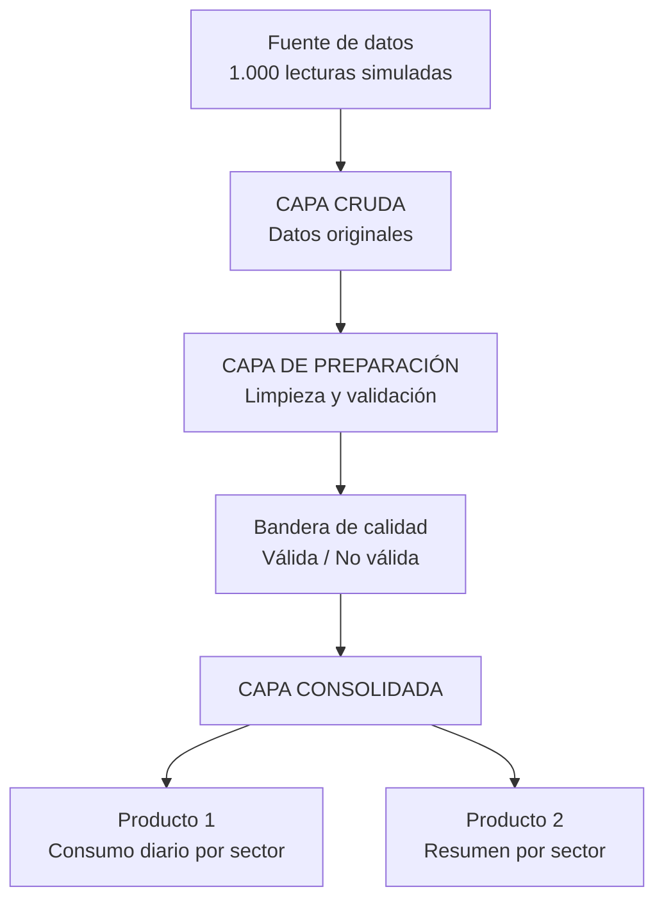
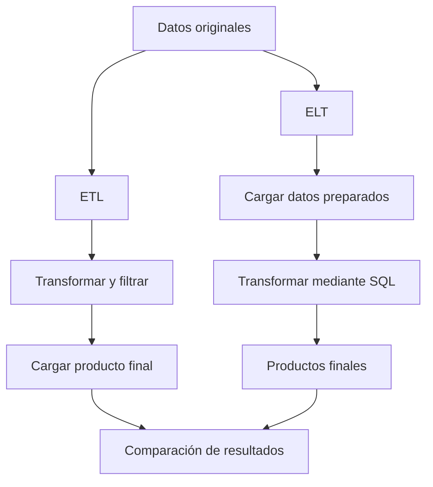
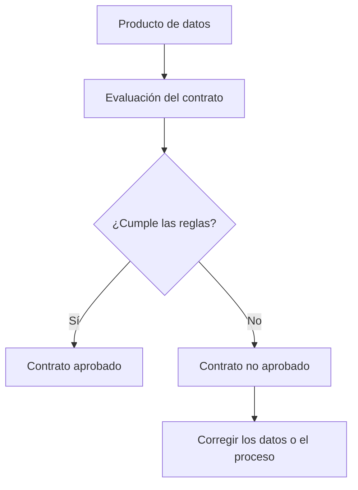

# INFORME TÉCNICO – TAREA T18
## ETL vs. ELT: ¿Dónde se transforma el dato?

**Proyecto:** Simulación de un pipeline de datos de un acueducto  
**Módulo:** Construcción de Pipelines de Datos  
**Tecnologías:** Python, PySpark, SQL y Parquet.

---

## 1. Introducción

El presente proyecto tiene como objetivo comparar los procesos ETL y ELT mediante la construcción de un pipeline de datos basado en un escenario ficticio de un acueducto.

Se simularon 1.000 registros de lecturas de consumo de agua, incluyendo información sobre fechas, sectores, consumo en metros cúbicos, presión y calidad de los datos.

A partir de esta información se construyó una arquitectura por capas que permite almacenar, preparar, transformar y validar los datos, con el propósito de analizar las ventajas de cada enfoque.

## 2. Objetivo

Implementar y comparar los procesos ETL y ELT mediante un pipeline de datos que permita:

- Conservar los datos originales.
- Identificar lecturas válidas y no válidas.
- Construir productos de información mediante SQL.
- Verificar la calidad mediante contratos.
- Comparar los resultados de ETL y ELT.
- Realizar reprocesamientos sobre ventanas específicas de fechas.

## 3. Arquitectura del proyecto

El proyecto utiliza una arquitectura de tres capas:

1. **Capa cruda:** almacena las lecturas originales sin aplicar filtros de calidad.
2. **Capa de preparación:** transforma los tipos de datos, normaliza los sectores y agrega una bandera para identificar las lecturas válidas.
3. **Capa consolidada:** contiene los productos finales utilizados para analizar el consumo de agua.

### Diagrama de arquitectura

Esta arquitectura permite conservar la información y mantener visible el estado de calidad de cada lectura.

## 4. Comparación entre ETL y ELT

### ETL

ETL significa Extraer, Transformar y Cargar. En este proceso los datos se transforman antes de almacenarse en el producto final.

En el proyecto, las lecturas se filtran para utilizar únicamente aquellas que cumplen las reglas de calidad. Posteriormente, se agrupan por fecha y sector para calcular el consumo total y la presión promedio.

### ELT

ELT significa Extraer, Cargar y Transformar. En este enfoque los datos se cargan primero en la capa de preparación y posteriormente se transforman mediante consultas SQL.

Esto permite conservar las lecturas y aplicar diferentes reglas de negocio sin perder la información original.

### Diagrama comparativo

La principal diferencia es el momento en que se realizan las transformaciones.

## 5. Productos de datos desarrollados

Se construyeron dos productos mediante consultas SQL.

**Producto 1: Consumo diario por sector**

Permite conocer la cantidad de lecturas, el consumo total de agua y la presión promedio para cada sector en cada fecha.

**Producto 2: Resumen general por sector**

Permite identificar el consumo total, el consumo promedio y la presión promedio de cada sector.

Estos productos facilitan el análisis de la distribución del consumo de agua.

## 6. Contratos de datos

Se implementaron contratos para verificar que los productos cumplan las condiciones establecidas.

Los contratos revisan:

- Existencia de las columnas obligatorias.
- Ausencia de fechas nulas en el producto diario.
- Ausencia de sectores vacíos.
- Ausencia de consumos totales negativos.

Cada contrato permite identificar errores antes de utilizar los productos finales.

### Diagrama de validación

## 7. Reproceso de datos

Se implementó un reproceso para una ventana comprendida entre el 5 y el 7 de enero de 2025.

El objetivo es volver a generar los resultados correspondientes a un periodo específico sin procesar nuevamente todo el conjunto de datos.

En esta simulación, el resultado de la ventana se guarda en una salida independiente.

Esto facilita analizar los cambios de información y el alcance del reprocesamiento.

## 8. Comparación y medición de resultados

Para comprobar que ambos enfoques producen información equivalente, se comparan los resultados del producto ETL y el primer producto ELT.

Se consideran los siguientes indicadores:

- Cantidad de registros.
- Consumo total de agua.
- Diferencias entre los productos.
- Lecturas válidas y excluidas.
- Registros correspondientes a la ventana de reproceso.

La condición esperada es que el producto ELT filtrado reproduzca los mismos resultados del ETL.

Las cifras definitivas deben obtenerse de la ejecución del programa y del archivo `salidas/metricas.json`.

## 9. Decisión técnica

Para este escenario se propone utilizar ELT porque permite conservar las lecturas originales y mantener la información sobre su calidad.

Esta alternativa facilita la trazabilidad, la aplicación de nuevas reglas y la construcción de diferentes productos a partir de una misma capa de preparación.

Sin embargo, ETL puede resultar conveniente cuando se necesita reducir la cantidad de información que se almacena y las reglas de transformación están claramente definidas.

La decisión debe considerar los costos de almacenamiento, lectura, escritura y reprocesamiento.

## 10. Conclusiones

1. La arquitectura por capas permite organizar los datos y separar las responsabilidades de cada etapa del pipeline.

2. ETL y ELT pueden producir resultados equivalentes cuando aplican las mismas reglas de transformación y filtrado.

3. La conservación de las lecturas con una bandera de calidad permite mejorar la trazabilidad y consultar los registros excluidos.

4. Los contratos de datos ayudan a detectar inconsistencias y verificar las condiciones de los productos antes de utilizarlos.

5. El reprocesamiento por ventanas permite trabajar sobre periodos específicos y evitar reconstruir innecesariamente todo el histórico.

6. La elección entre ETL y ELT debe justificarse mediante mediciones y necesidades del proyecto, considerando tanto el costo como la calidad y trazabilidad de la información.

---

**Nota:** Este proyecto utiliza datos ficticios generados para fines académicos. Las mediciones y resultados definitivos corresponden a la ejecución del código desarrollado.
